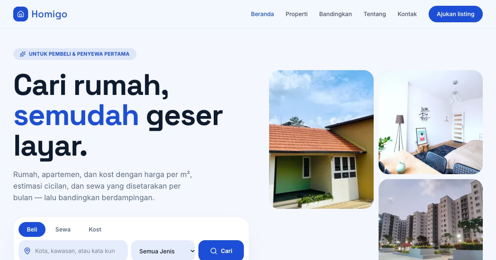

# Homigo — Rumah pertama & tempat sewa

Marketplace untuk pembeli dan penyewa pertama: rumah terjangkau, apartemen, kost, dan gudang. Gaya aplikasi biru dengan Space Grotesk.

**Demo live:** https://properti-homigo.pintuweb.id



> Purwarupa desain. Listing, agen, harga, dan alamat adalah contoh fiktif — alamat hanya sampai tingkat kawasan dan tidak ada nomor telepon. Semua formulir (jadwal survei, kontak) hanya menampilkan ringkasan dan tidak mengirim data.

## Fitur khas

- `/bandingkan` — taruh dua sampai tiga listing berdampingan: pengeluaran per bulan (cicilan vs sewa setara), bayar di awal, harga per m², luas, kamar, dan fasilitas; angka terbaik tiap baris ditandai dan tautannya bisa dibagikan (`?id=1,2`).
- Filter harga memisahkan beli dan sewa; sewa tahunan disetarakan per bulan.
- Kalkulator KPR di beranda.

## Fitur bersama

- Katalog `/properti` dengan filter status, jenis, kota, harga (beli dan sewa dipisah), kamar, dan urutan.
- Halaman detail: galeri, spesifikasi termasuk harga per m², peta tingkat kecamatan, dan formulir jadwal survei (tanggal dihitung dalam WIB di peramban).
- `/kontak` dengan pilihan topik (tautan "Ajukan listing" membuka topik jual), `/tentang` dengan daftar agen yang disusun dari data.
- Semua konten berasal dari `lib/data.js`; statistik dihitung dari data, bukan klaim.

## Halaman

`/` · `/bandingkan` · `/kontak` · `/properti` · `/properti/[id]` · `/tentang`

## Teknologi

- Next.js 15.5 (App Router) dan React 19
- Tailwind CSS v4
- JavaScript
- Framer Motion, Lucide (ikon)
- Font: Space Grotesk, Inter (next/font)
- SEO: metadata per halaman, Open Graph, JSON-LD, sitemap.xml, dan robots.txt

## Menjalankan secara lokal

```bash
npm install
npm run dev
```

Buka http://localhost:3000. Untuk build produksi: `npm run build` lalu `npm start`.

## Kredit foto

22 foto listing, kawasan, dan beranda berlisensi CC0 1.0 atau domain publik (WordPress Photo Directory dan
Wikimedia Commons), dipotong ke 4:3, nadanya disamakan, lalu disimpan sebagai WebP. Daftar lengkap per berkas —
judul, pembuat, halaman sumber, lisensi — ada di [`public/images/SUMBER.md`](public/images/SUMBER.md).

3 potret konsultan di `public/images/agen/` adalah ilustrasi buatan sendiri untuk tokoh fiktif (bukan foto orang
sungguhan), dibuat dari kode di `scripts/ilustrasi/potret.mjs`.

---

Bagian dari koleksi 4 template marketplace properti di [PortalProperti](https://www.pintuweb.id/website-properti). Dibuat oleh [PintuWeb](https://www.pintuweb.id), jasa pembuatan website.
